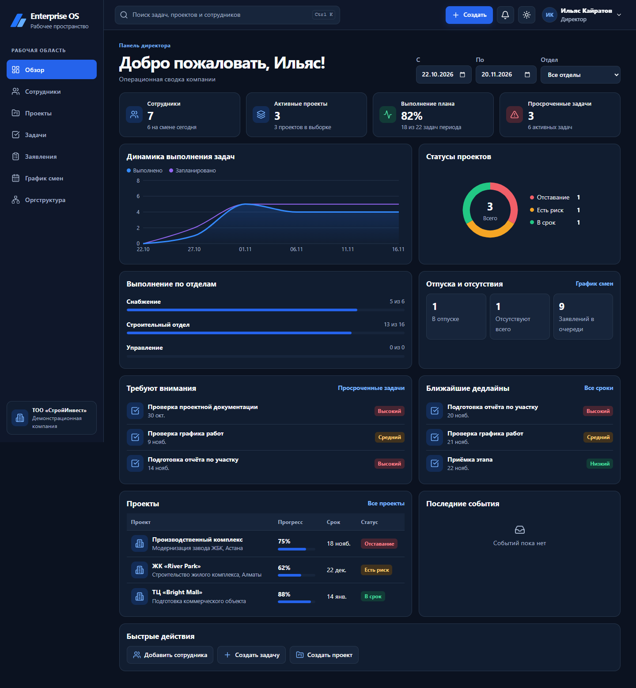
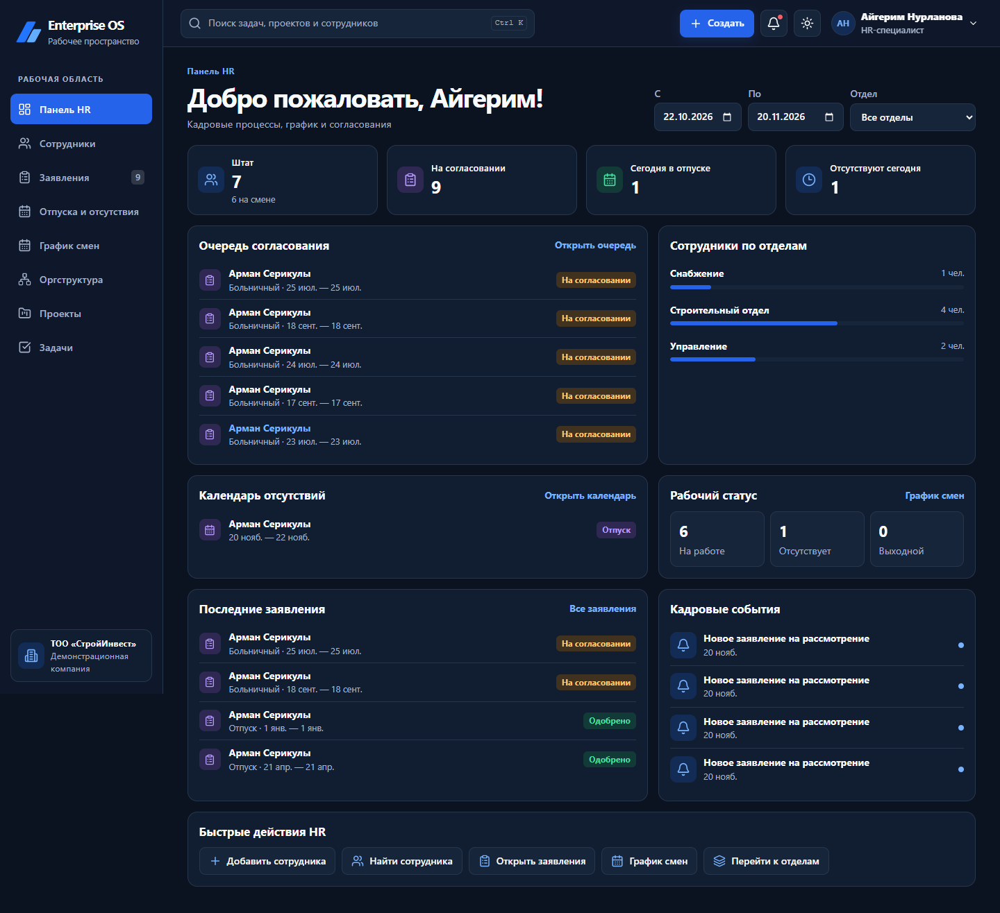
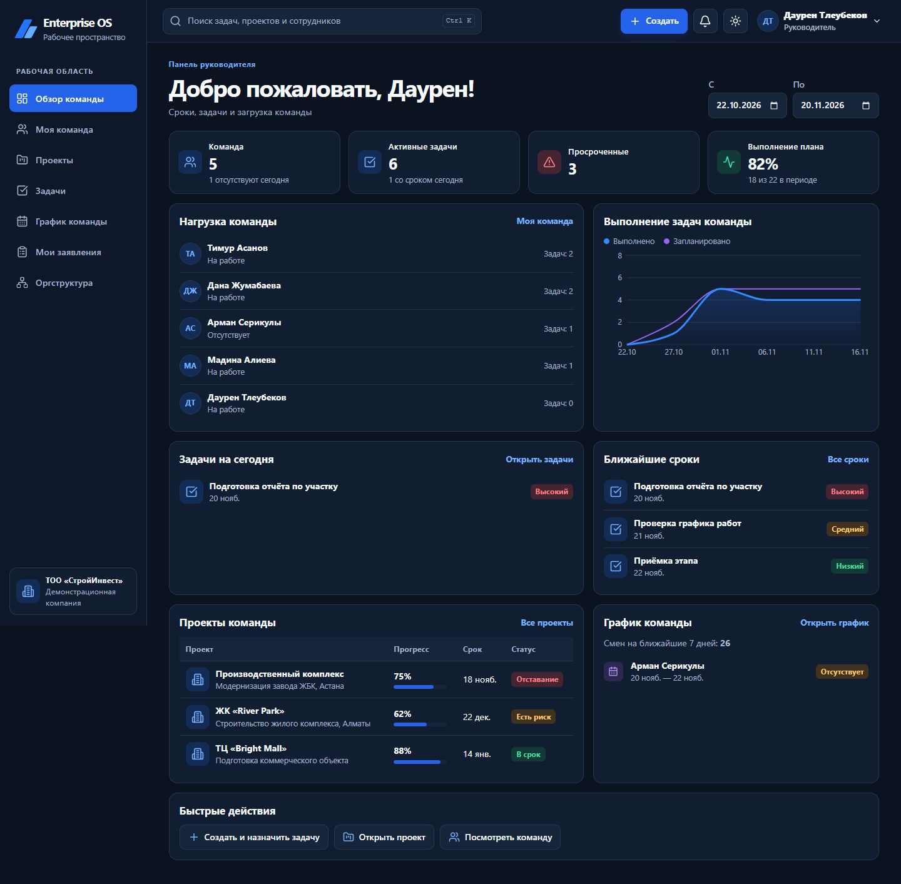
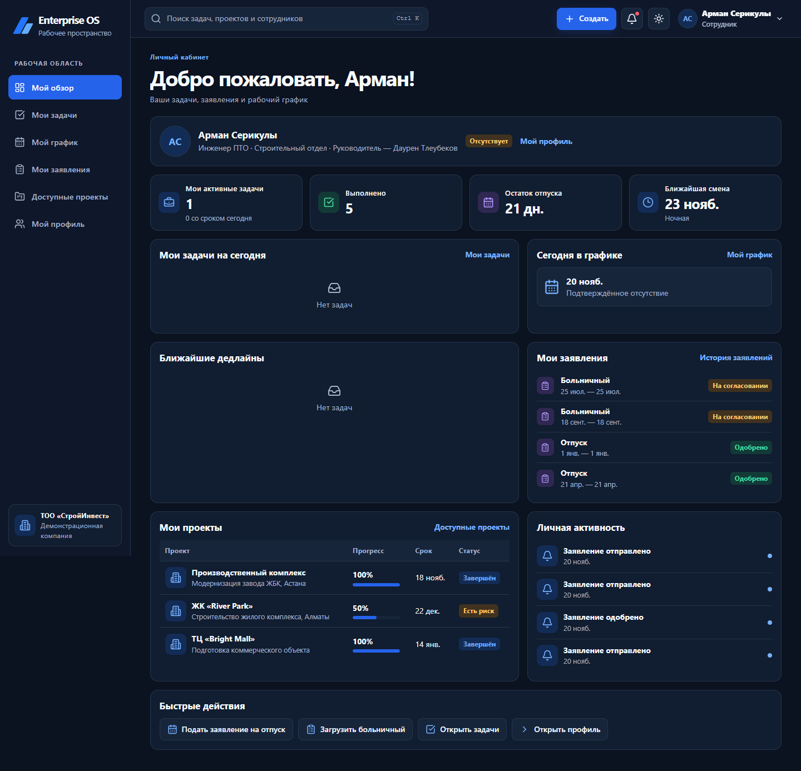
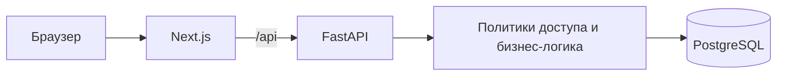

# Enterprise OS

**MVP v0.2 Professional Edition** · Русскоязычная рабочая среда для компаний

Enterprise OS объединяет проекты, задачи, смены и кадровые согласования. Руководители видят сроки и нагрузку, HR обрабатывает заявления, сотрудники работают с личным графиком и задачами. У каждой роли своё рабочее пространство и доступ к данным в пределах полномочий.

## Возможности

- Справочник сотрудников, отделы, оргструктура и рабочие статусы.
- Проекты, задачи, приоритеты и сроки. Для задач доступны список и доска.
- Недельный график смен, согласование отпусков и учёт отсутствий.
- Закрытый доступ к вложениям заявлений, история решений и уведомления.
- Поиск через `Ctrl+K`, светлая и тёмная темы, адаптивный интерфейс.

## Рабочие пространства

| Роль | Главный экран |
| --- | --- |
| Директор | Показатели компании, выполнение плана по отделам, проекты, сроки и события. |
| HR | Очередь согласований, отпуска и отсутствия, кадровые показатели и уведомления. |
| Руководитель | Загрузка команды, задачи на сегодня, доступные проекты и смены. |
| Сотрудник | Личные задачи, график, остаток отпуска, заявления и уведомления. |

## Скриншоты

Все четыре панели сняты на отдельной базе с демонстрационными записями.

<details open>
<summary>Директор</summary>



</details>

<details>
<summary>HR</summary>



</details>

<details>
<summary>Руководитель</summary>



</details>

<details>
<summary>Сотрудник</summary>



</details>

## Стек и архитектура

| Слой | Технологии |
| --- | --- |
| Интерфейс | Next.js, React, TypeScript, Tailwind CSS, Recharts |
| API | Python, FastAPI, SQLAlchemy, Pydantic |
| Данные | PostgreSQL, psycopg, миграции Alembic |
| Проверки | pytest, Playwright, ESLint, TypeScript |
| Локальный запуск | PowerShell, BAT, Docker Compose для PostgreSQL |



Браузер отправляет запросы через Next.js с одного origin. FastAPI восстанавливает сессию, определяет компанию и применяет серверные политики. PostgreSQL хранит операционные записи и приватные вложения. Подробности см. в [docs/architecture.md](docs/architecture.md).

| Каталог | Содержимое |
| --- | --- |
| `frontend/` | Страницы, компоненты, дизайн-система и E2E-тесты. |
| `backend/` | REST API, модели, политики, миграции и backend-тесты. |
| `scripts/` | Команды запуска, миграций и создания демоданных. |
| `docs/` | Описание архитектуры и скриншоты. |

## Локальный запуск всего приложения через Docker Compose

Нужен Docker с Compose v2. При первом запуске скопируйте `.env.example` в `.env`. Если `.env` уже существует, дополните его по шаблону. Задайте свой `POSTGRES_PASSWORD`. Compose передаёт параметры PostgreSQL контейнерам отдельно и не использует `DATABASE_URL` с хоста.

```powershell
docker compose up --build --wait
docker compose ps --all
curl.exe --noproxy "*" --fail http://127.0.0.1:3000/api/health/live
curl.exe --noproxy "*" --fail http://127.0.0.1:3000/api/health/ready
```

Откройте [localhost:3000](http://localhost:3000). Сервис `migrate` ждёт готовности БД, выполняет `alembic upgrade head` и завершается. API стартует после его успешного завершения. Для отдельного запуска миграций используйте `docker compose run --rm --build migrate`. `/api/health/live` проверяет ответ процесса, `/api/health/ready` требует подключения к БД и совпадения ревизий Alembic. При недоступной или устаревшей схеме readiness возвращает HTTP 503.

Для демо и проверки контейнеров создайте `.env.v03-check` из `.env.example`. Задайте отдельный пароль PostgreSQL, имя базы `enterprise_v03_check` и свободные порты, например `POSTGRES_PORT=55433` и `WEB_PORT=3300`. Для этого примера укажите `APP_ORIGIN=http://localhost:3300`. Имя Compose-проекта `enterprise-v03-check` создаёт отдельный том. Для новой демобазы выполните:

```powershell
docker compose --env-file .env.v03-check -p enterprise-v03-check up --build --wait
if ($LASTEXITCODE -ne 0) { throw 'Демо-окружение не готово' }
$env:DEMO_PASSWORD = [System.Net.NetworkCredential]::new('', (Read-Host 'Пароль демо-аккаунтов' -AsSecureString)).Password
try { docker compose --env-file .env.v03-check -p enterprise-v03-check run --rm --no-deps -e DEMO_PASSWORD backend python -m app.seed }
finally { Remove-Item Env:DEMO_PASSWORD }
```

Для остановки демо используйте `docker compose --env-file .env.v03-check -p enterprise-v03-check down`. Файл с локальными секретами игнорируется Git.

Frontend и порт БД опубликованы только на loopback. При изменении `WEB_PORT` выставьте соответствующий `APP_ORIGIN`. Старая локальная база Compose использует тот же том `enterprise-db`. При повторном запуске сохраняйте прежнее имя базы, пользователя и пароль. Для обычной остановки используйте `docker compose down`, он сохраняет именованный том.

## Локальный запуск на Windows

Установите Python и Node.js по версиям из `.python-version` и `.nvmrc` соответственно. Вариант ниже использует Docker Compose для базы. С уже установленным PostgreSQL создайте отдельную базу для разработки и пропустите команду Docker. Перед запуском Windows-лаунчера освободите порты `3000` и `8000`. Если одновременно нужен Compose-frontend, задайте ему другой `WEB_PORT` и соответствующий `APP_ORIGIN`.

### Первый запуск из чистой копии

1. Скопируйте шаблон.

   ```powershell
   Copy-Item .env.example .env
   ```

   Для Python, запущенного на хосте, задайте `DATABASE_URL` в `.env`. Если через Compose запущена только БД, заполните также `POSTGRES_PASSWORD`, используйте в URL тот же пароль и порт `POSTGRES_PORT`. Закодируйте специальные символы пароля для URL. При полном запуске через Compose переменная `DATABASE_URL` из файла не используется.

   ```dotenv
   DATABASE_URL=postgresql+psycopg://enterprise:<URL-encoded-password>@127.0.0.1:5432/enterprise
   ```

2. Запустите PostgreSQL и установите зависимости.

   ```powershell
   docker compose up -d db
   python -m venv .venv
   .\.venv\Scripts\python.exe -m pip install -r backend/requirements-test.txt
   npm.cmd --prefix frontend ci
   ```

3. Когда PostgreSQL будет готов, примените миграции к новой базе разработки.

   ```powershell
   .\scripts\migrate.ps1
   ```

4. Для знакомства с продуктом заполните **отдельную пустую демобазу**. Перед запуском проверьте, куда указывает `DATABASE_URL`. Пароль от 12 до 128 символов вводится в скрытом виде.

   ```powershell
   $env:DEMO_PASSWORD = [System.Net.NetworkCredential]::new('', (Read-Host 'Пароль демоаккаунтов' -AsSecureString)).Password
   .\scripts\seed.ps1
   Remove-Item Env:DEMO_PASSWORD
   ```

   | Роль | Демонстрационный email |
   | --- | --- |
   | Директор | `director@demo.example` |
   | HR | `hr@demo.example` |
   | Руководитель | `manager@demo.example` |
   | Сотрудник | `employee@demo.example` |

5. Запустите backend и frontend в двух терминалах из корня проекта.

   ```powershell
   .\scripts\backend.ps1
   ```

   ```powershell
   .\scripts\frontend.ps1
   ```

   Интерфейс доступен на [localhost:3000](http://localhost:3000), справка API — на [127.0.0.1:8000/docs](http://127.0.0.1:8000/docs).

### Запуск BAT для настроенного переносимого окружения

`start_enterprise_os.bat` рассчитан на переносимый PostgreSQL в `.local/` с парольной аутентификацией на `127.0.0.1:55432`. Для этого варианта нужны рабочая `.venv`, установленные зависимости frontend и база с текущими миграциями. `DATABASE_URL` ищется в переменной процесса, затем в `.local/dev.env`, затем в `.env`. Для запуска из чистой копии с Docker используйте команды выше.

`stop_enterprise_os.bat` останавливает процессы, которые запустил launcher. Уже запущенный PostgreSQL продолжает работать. Журналы находятся в `.local/logs/` и `.local/postgres.log`. Для автоматизированного запуска задайте `ENTERPRISE_OS_NO_BROWSER=1`.

## Разработка

- Скрипты `backend.ps1` и `frontend.ps1` запускают серверы в режиме разработки с перезагрузкой при изменении кода.
- Launcher использует production-сборку, если она уже создана. После изменений остановите frontend и выполните `npm.cmd --prefix frontend run build`.
- Настройки VS Code скрывают локальные артефакты из Explorer. Зависимость от расширений отсутствует.

## Тестирование

Обычный запуск pytest использует SQLite. Для PostgreSQL создайте отдельную пустую базу с именем `enterprise_test`. Из `backend/` примените к ней `python -m alembic upgrade head` с её адресом в `DATABASE_URL`, запустите `python -m alembic check`, затем передайте тот же адрес в `ENTERPRISE_TEST_DATABASE_URL` и выполните `python -m pytest -q tests/test_workflows.py`. Тесты записывают данные и требуют свежую мигрированную базу при каждом повторе. GitHub Actions выполняет оба набора и smoke-тест всего Compose-стека.

Из корня репозитория в PowerShell:

```powershell
Push-Location backend
..\.venv\Scripts\python.exe -m pytest -q
Pop-Location
npm.cmd --prefix frontend run lint
npm.cmd --prefix frontend run build
npm.cmd --prefix frontend run typecheck
```

Для Playwright запустите приложение **с отдельной тестовой PostgreSQL**, к которой применены миграции и добавлены демоданные. E2E создают заявления и проверяют доступ к вложениям. Установите Chromium и запустите сценарии из `frontend`:

```powershell
npx.cmd playwright install chromium
$env:DEMO_PASSWORD = [System.Net.NetworkCredential]::new('', (Read-Host 'Пароль тестовых аккаунтов' -AsSecureString)).Password
npm.cmd run e2e
Remove-Item Env:DEMO_PASSWORD
```

По умолчанию E2E обращаются к `http://localhost:3000`. Для другого адреса задайте `E2E_URL`. Проверьте, что пароль передан. При его отсутствии тесты пропускаются.

## Безопасность

- Сервер проверяет роль, принадлежность записи компании и право на скачивание вложения.
- Пароли хешируются Argon2. База хранит хеш сессионного токена. Сессия передаётся в HTTP-only cookie.
- Больничные хранятся в закрытой таблице. Перед скачиванием сервер проверяет доступ к заявлению.
- Сброс пароля требует SMTP с STARTTLS. Одноразовая ссылка действует 30 минут, а успешный сброс отзывает действующие сессии.

Перед внедрением настройте HTTPS, `COOKIE_SECURE=true`, хранение секретов, ограничения запросов на прокси, проверяемые резервные копии и аудит доступа к персональным данным. Храните реальные настройки, выгрузки и документы вне коммитов.

## Roadmap

- Серверная пагинация списков и оптимизация запросов для крупных компаний.
- Отчёты и расширение журнала кадровых операций.
- Интеграции и автоматизация согласований.

## Известные ограничения

- Прогресс проекта считается по задачам, видимым роли, без отменённых задач. Отдельной роли владельца проекта пока нет.
- Статус задачи можно поменять из списка или карточки. Перетаскивание на доске не реализовано.
- Пагинация справочника выполняется на клиенте. Остаток отпуска учитывается в календарных днях текущего года.

История изменений и описание v0.1 находятся в [CHANGELOG.md](CHANGELOG.md).
